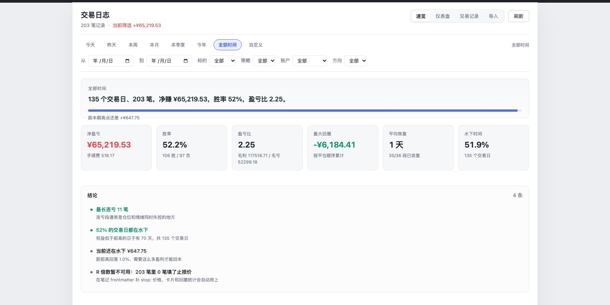
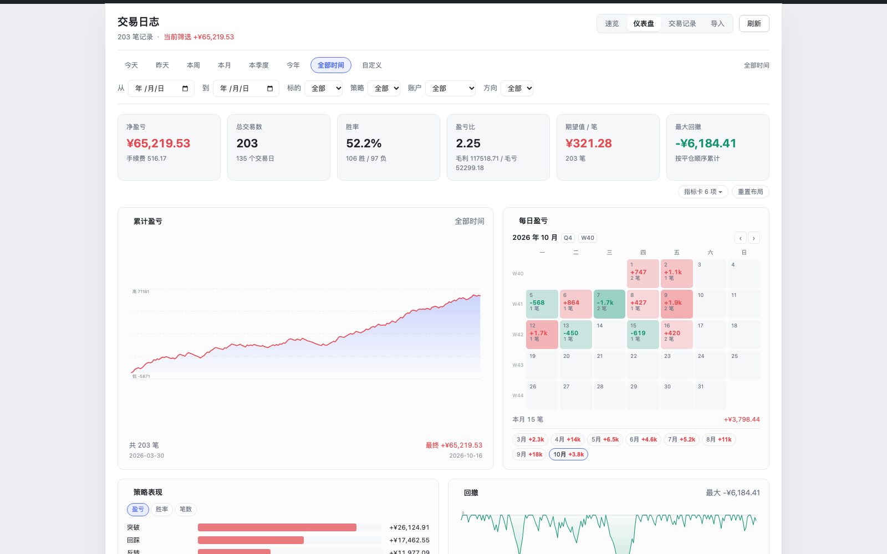
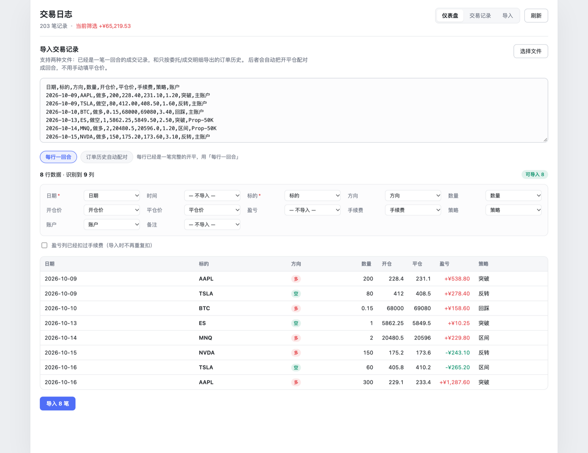
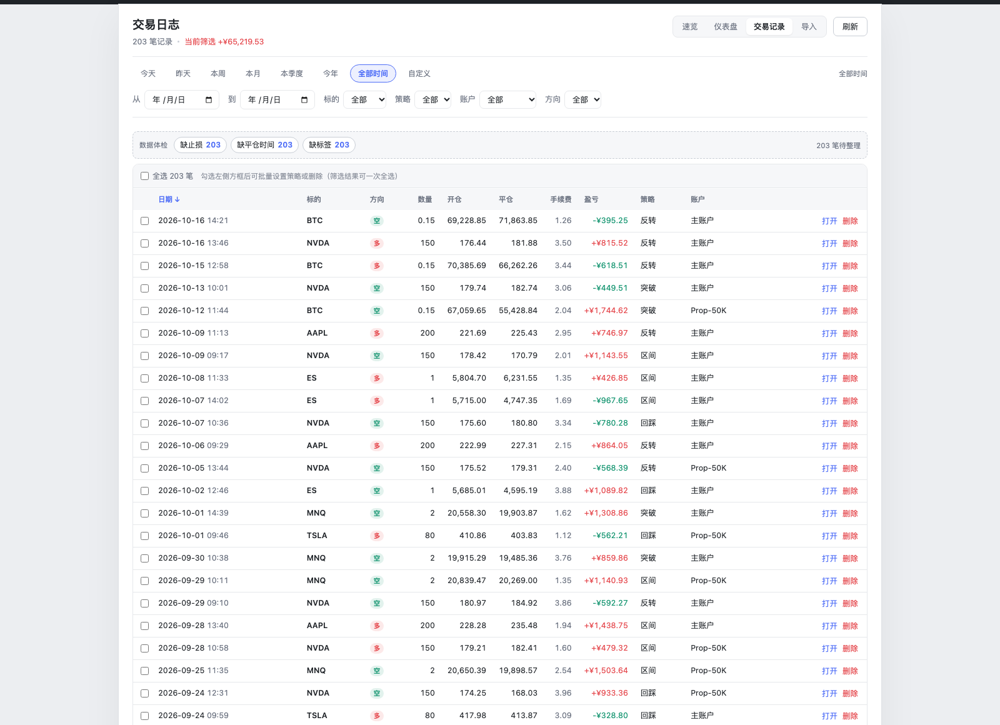

# 交易日志（Trade Journal for Obsidian）

[](https://github.com/wangxiaoqian2042/trade-journal/releases/latest)
[](https://github.com/wangxiaoqian2042/trade-journal/releases)

> **⬇️ 只是想用，不打算编译？** 去 [**Releases**](https://github.com/wangxiaoqian2042/trade-journal/releases/latest) 下载 `trade-journal-vX.Y.Z.zip`，解压后按里面的《安装说明》三步装好即可。不需要 Node、不需要命令行。

本地优先的交易日志插件。每笔交易是 vault 里的一个 Markdown 文件，CSV 手工导入，所有统计在自己机器上算，不联网、不要账号。

> English README → [README.en.md](README.en.md)





## 能做什么

- **速览页**：一句话讲清这期赚没赚，配 6 张关键卡、结论清单和强项/短板。结论都是阈值判断（连亏长度、单笔亏损是平均盈利的几倍、利润集中度、水下时间占比…），不给玄学建议
- **多账户**：导入时选账户，顶部一键切换（全部 / AMP / Tradovate / 未分类），各账户的仪表盘、回撤、胜率完全独立；去重按账户隔离，两个账户的同价成交不会互相吞掉
- **两种导入模式**：一行一回合的成交记录；或者只有委托/成交明细的「订单历史」（自动 FIFO 配对开平仓）
- **可放主区域或侧边栏**：默认在主区域新标签页打开，也能挂到右侧边栏，视图右上角一键切换
- **仪表盘**：25 个指标可自选（净盈亏、胜率、盈亏比、期望值、最大回撤、平均恢复、水下时间、连胜连亏…），带环比（较上周/较上月…）
- **回撤体检**：把权益曲线切成一段段回撤，逐段看幅度、下行天数、恢复用了几天、有没有收复；不只看最大回撤那一个数
- **时间档**：今天 / 昨天 / 本周 / 本月 / 本季度 / 今年 / 全部 / 自定义区间
- **可拖拽布局**：卡片按住表头换位、右下角拉伸改大小，窄到侧边栏会自动降列，布局自动记住
- **下钻联动**：点日历某天、点策略/标的/星期条、点多空卡片 → 直接跳到交易记录并带上筛选；点曲线上的点 → 打开那一笔的笔记
- **权益曲线**：按平仓时间累计，鼠标悬停看某一笔
- **分组统计**：按策略 / 按标的 / 按星期的盈亏与胜率对比
- **每日盈亏月历**：红盈绿亏（A 股习惯），带 ISO 周次，一眼看出哪个月在亏钱；底部列出所有有交易的月份，点一下就跳过去，不用逐月翻
- **交易记录表**：排序、筛选（日期区间 / 标的 / 策略 / 账户 / 方向）、双击打开原文
- **批量操作**：勾选若干笔（或按当前筛选一键全选）后统一删除，删除走回收站可还原；也能一次给这批笔记打上同一个策略
- **数据体检**：顶部列出缺策略 / 缺止损 / 缺平仓时间 / 缺标签 / 没写复盘各多少笔，点一下就只看这一类，补完再点掉。数字跟着当前筛选走，不是写死的总数
- **数据可迁移**：全部是 Markdown + frontmatter，能进 Git、能同步、能手动改

## 安装

1. 把这三个文件放进 `<你的 vault>/.obsidian/plugins/trade-journal/`：
   - `main.js`
   - `manifest.json`
   - `styles.css`
2. Obsidian → 设置 → 第三方插件 → 关闭安全模式 → 刷新 → 启用 **Trade Journal**
3. 左侧栏出现折线图图标，点它，或命令面板搜「打开交易日志」
4. 默认在主区域（中间编辑区）以新标签页打开；想挂在右边，用视图右上角的按钮切换，或在设置里把「默认打开位置」改成右侧边栏

> 本项目没有上架社区市场，属于自用插件，装法就是上面这种手动拷贝。

`.obsidian` 默认是隐藏目录。不想折腾隐藏文件的话：设置 → 第三方插件 → 「已安装插件」右侧的文件夹图标，会直接打开 `plugins` 目录，把 `trade-journal` 文件夹拖进去即可。

## 分发给别人

三种方式，按对方的动手能力选：

**① 传 zip（最省事，谁都装得上）**
把 `trade-journal-vX.Y.Z.zip` 直接发给对方（微信/网盘都行）。解压后把 `trade-journal` 文件夹放进 `<vault>/.obsidian/plugins/`，关掉受限模式，启用。压缩包里自带《安装说明.txt》。

**② 只发仓库地址 + BRAT（能自动更新）**
对方先装 [BRAT](https://github.com/TfTHacker/obsidian42-brat) 插件 → 命令面板执行 `BRAT: Add a beta plugin for testing` → 填本仓库地址 `wangxiaoqian2042/trade-journal` → 确定。之后插件更新，BRAT 会提示。

**③ 只发仓库地址（不推荐给非技术用户）**
仓库里只有源码，没有 `main.js`。对方得自己 `npm install && npm run build`，或者自己在 Releases 页面找 zip——多绕一步，容易被"这不是安装包吗"卡住。真要发地址，请连 Releases 链接一起发。

> 想进 Obsidian 官方社区市场，需要向 [obsidian-releases](https://github.com/obsidianmd/obsidian-releases) 提交人工审核（仓库公开、许可证合规、无混淆代码）。个人自用/小范围分发不必走这条。

## 界面

导入页：左边粘贴 CSV，中间是字段映射（自动识别，可手改），下面是逐行预览，确认无误再点导入。



交易记录：勾选左侧方框可批量删除或批量打策略，表头方框选的是「当前筛选结果全部」。



## 用法

### 导入 CSV

打开插件 → 「导入」页 → 粘贴 CSV 或点「选择文件」。

支持的分隔符：`,` `;` `Tab` `|`。支持带引号的字段、字段内换行、`$1,234.50`、`(250.00)` 这种负数写法。

常用列名对照（不区分大小写，中英都认）：

| 字段 | 可以叫 |
|---|---|
| 日期 | date, 日期, trade date, 开仓时间, 平仓时间, entry time |
| 时间 | time, 时间 |
| 平仓时间 | exited at, exit time, closed at, 平仓时间（可选，用来算持仓时长） |
| 标的 | symbol, ticker, instrument, 代码, 标的, 品种 |
| 方向 | side, direction, action, 方向, 多空, 买卖 |
| 数量 | qty, quantity, size, shares, volume, 数量, 手数 |
| 开仓价 | entry, entry price, open price, 开仓价, 买入价 |
| 平仓价 | exit, exit price, close price, 平仓价, 卖出价 |
| 盈亏 | pnl, p&l, profit, net pnl, 盈亏, 收益 |
| 手续费 | fees, fee, commission, 手续费, 佣金 |
| 手续费（附加） | commissions, brokerage, 交易佣金（两列都映射时相加，Tradovate 用得上） |
| 策略 | setup, strategy, playbook, 策略, 战法 |
| 账户 | account, acct, 账户 |
| 备注 | notes, comment, remarks, 备注 |

规则：

- **没有盈亏列** → 用 `(平仓价 − 开仓价) × 数量 × 方向 − 手续费` 自动算
- **有盈亏列** → 直接用它，再扣掉手续费（避免重复计费请在券商侧确认口径）
- **日期格式**：`2026-10-09`、`10/09/2026`、`25/09/2026`、`Oct 9, 2026`、带时分秒的都认
- **去重**：日期 + 标的 + 开仓价 + 平仓价 + 数量 相同视为同一笔，重复导入会跳过

`examples/` 下有两个可直接试的样例（中文表头 / 英文表头）。

### 生成的笔记长这样

`Trading/20261009-AAPL-突破.md`：

```markdown
---
type: "trade"
date: "2026-10-09"
time: "09:31"
symbol: "AAPL"
direction: "long"
entry: 228.4
exit: 231.1
quantity: 200
fees: 1.2
pnl: 538.8
setup: "突破"
account: "主账户"
tags:
  - "trade"
---

盘中在 228.4 进场，突破前高后缩量回踩不破再进。
```

正文就是你的复盘，随便写。改 frontmatter 里的数字，仪表盘会跟着变。

### 设置

- **导入到账户**：导入页顶部手动填写（必填，不预填），写进笔记的 `account` 字段；已有账户可点快捷按钮填入
- **交易笔记目录**：默认 `Trading`
- **货币符号**：默认 `¥`，做美股可以改成 `$`
- **打平区间**：`|盈亏| ≤ 阈值` 的交易算打平，不计入胜率、不打断连胜连亏。默认 0；期货建议填 1–2 个最小跳动乘乘数，把手续费级别的噪音挡掉

## 开发

```bash
npm install
npm run dev     # 监听构建
npm run build   # 类型检查 + 生产构建
npm run demo    # 生成 demo/index.html 界面预览（浏览器直接打开）
```

手动跑逻辑自测（CSV 解析、指标计算、frontmatter 往返，44 项断言）：

```bash
./node_modules/.bin/esbuild scripts/test.ts --bundle --platform=node --format=cjs --outfile=/tmp/tjtest.cjs && node /tmp/tjtest.cjs
```

### 目录

```
src/
  main.ts                  插件入口、命令、设置页
  views/JournalView.tsx    Obsidian 视图，挂载 React
  components/
    JournalApp.tsx         三个 tab + 筛选
    Dashboard.tsx          指标卡与分组统计
    charts.tsx             权益曲线 / 条形对比 / 热力图（手写 SVG）
    TradeTable.tsx         交易表格
    ImportPanel.tsx        CSV 导入与列映射
    ui.tsx                 格式化与小组件
  services/
    store.ts               vault 读写
    csv.ts                 CSV 解析与列识别
    analytics.ts           指标计算
    frontmatter.ts         极简 YAML 读写
```

依赖只有 React 19；图表全是手写 SVG，所以 `main.js` 只有 250KB 左右，没有图表库。

## 没有做的部分

- 券商自动同步（要后端和各家 API，不做）
- 云账号、订阅、多设备同步（用 Obsidian 自己的同步即可）
- 多语言界面（只有中文）
- 期权 / 期货乘数、分批建仓合并（当前一笔一行，手续费单独扣）
